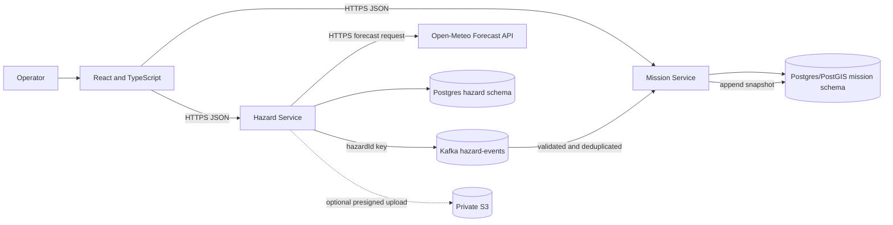

# Architecture

## Status

Mission Service CRUD and the PostGIS mission-geometry/restricted-zone foundation are implemented and tested. The React/Vite mission workspace and a separate stateless Hazard Service weather-assessment API are implemented. Hazard report persistence, Kafka flow, risk scoring, authentication, and deployment remain planned. SkyGrid is a decision-support prototype with demonstration data, not flight authorization or safety certification. Approved workflow is cloud-first: VS Code/Codex, local Java 25 and Vite, managed PostgreSQL/PostGIS and Kafka, AWS S3, Vercel frontend, and a compatible container host for services. No local database, broker, Docker, or Compose setup. Docker is introduced in deployment preparation only.

Spring Boot 3.5.16 is the pinned candidate. Official Spring Boot 3.5 system requirements list Java compatibility through Java 25. This verifies framework support, not this project's build, dependencies, database driver, or hosting runtime; those require build/runtime verification.

## Components

Managed PostgreSQL may host both schemas or separate databases; each service receives least-privilege access only to its owned schema/data. The existing Neon development database is PostgreSQL 18.6 with PostGIS enabled and verified by live SRID/intersection probes. Mission cannot read Hazard tables. The hazard projection from events remains planned.

## Responsibilities

- **Mission Service:** implemented mission CRUD, GeoJSON Polygon and LineString route validation/persistence, and PostGIS restricted-zone intersection checks for polygon areas. Deterministic scoring, hazard proximity, risk factors, immutable history, and event consumption/dedupe/reassessment remain planned. Risk engine remains inside Mission Service.
- Mission Service also owns the additive `airspace_features` spatial/source-record table and `airspace_dataset_imports` inventory. Local fixed-snapshot import is opt-in, idempotent by source identity, and commits bounded batches with an explicit attempt status; incomplete/failed attempts are excluded from viewport and restriction queries. Only validated compatible restriction geometries participate in the existing PostGIS check; non-spatial India AIP documents, FAA guidance, and other categories are excluded. Supplied-source coverage is unverified.
- **Hazard Service:** implemented stateless, on-demand Open-Meteo forecast retrieval and weather assessment for point, Polygon, or sampled route geometry. It validates WGS84 input, bounds route length/sample count, applies configured general planning thresholds, and returns missing values as null. It has no database, cache, Kafka, or risk-scoring behavior. Hazard report validation/persistence/retrieval, versioned event publication, optional attachment metadata and S3 presigning remain planned.
- **Frontend:** implemented mission list/detail, map, polygon editing, mission creation, and backend restricted-zone check presentation. Risk scores/factors/history and hazard reporting remain planned. No frontend spatial intersection or risk calculations.

Weather assessment is synchronous and requested from the frontend on demand for a saved mission's current Polygon or LineString geometry. Hazard Service calls the public Open-Meteo Forecast API over HTTPS; it does not share Mission database tables or persist forecasts. Polygon sampling uses its interior point. Route sampling follows the full geodesic ground track at bounded intervals, subject to configured maximum length and number of samples. Forecast calculations and threshold comparison run only in Hazard Service. This is weather decision support, not an aviation briefing, aircraft-specific limit evaluation, risk score, safety determination, or flight clearance. The UI exposes provider, retrieval time, horizon, thresholds, warnings, partial data, and limitations.

## Future event flow and reliability

Hazard Service validates and persists, then publishes a v1 JSON `HazardReported` event to `hazard-events`, keyed by hazard UUID. Event has stable UUID `eventId` and `schemaVersion`. Mission validates, updates its projection, finds affected missions, recalculates, appends snapshots, and records processed identity atomically with effects.

DB commit and Kafka publication are not atomic by default. Prefer a Hazard-owned transactional outbox with retry. If omitted, document persist/publish loss window and add recovery/reconciliation. Consumer retries are bounded; poison messages go to an explicit failure path such as a dead-letter topic. No exactly-once business claim.

## Ownership

- Mission schema: missions, risk_assessments, risk_factors, processed_events, hazard projection, restrictions.
- Hazard schema: hazards, attachments, optional outbox_events.
- No cross-service FKs. UUIDs crossing API/event boundaries are identifiers only. Separate schema-scoped DB roles are intended; local demo may use one bootstrap role only if documented.

## Failure controls

| Failure | Planned response |
|---|---|
| Invalid geometry | Validate structure, coordinate bounds and topology before persistence. |
| Hazard stored, publish fails | Outbox preferred; otherwise retry/reconciliation and observable failure. |
| Duplicate event | Stable ID, unique processed record, atomic effects. |
| Poison event | Bounded retry and explicit dead-letter/failure record. |
| Reassessment fails | Roll back effects/processed marker and retry within bounds. |
| Stale projection | Track event/projection progress and expose lag; never query Hazard tables. |
| Map tiles unavailable | Show map error and preserve form/API feedback; no paid map dependency. |

## Cloud resources and environment

Provisional production candidates (not approved/provisioned): Neon Free PostgreSQL 17; Aiven Kafka Free with compatible Kafka protocol/TLS/auth; one OCI Always Free Ampere A1 host for both Spring services; Vercel Hobby for static frontend. The separate existing development database is Neon PostgreSQL 18.6 with PostGIS verified. S3 is deferred for the MVP. No production resource identifiers, credentials, or selected regions are recorded. See `docs/CLOUD_PROVIDER_COMPARISON.md` for quotas/prices and caveats.

Required runtime configuration names are listed in `infra/.env.example`: Mission database JDBC URL/user/password; future Kafka bootstrap/security settings; allowed frontend CORS origin; weather endpoint/timeouts, route limits and general thresholds; optional AWS region/evidence bucket if S3 is later approved; and public Vite API base URLs. Hazard Service currently requires no database, Kafka, or provider credential. Database/Kafka credentials belong in the cloud host's secret manager. Prefer workload identity/role for AWS rather than static access keys. `VITE_*` values are bundled into browser assets and must contain public URLs only, never secrets.

Network requirements: services need outbound reachability to PostgreSQL and Kafka endpoints using provider-required ports and TLS; Hazard Service needs scoped S3 API access only if attachments are later enabled; Vercel users need HTTPS access to the API host. The provisional free stack assumes public TLS endpoints, not provider peering. Neon Free has no IP Allow or private networking; the database endpoint is publicly reachable and relies on TLS identity validation, strong credentials, and least-privilege roles. Aiven IP filter availability on Free must be verified. Do not use real sensitive data on this candidate. Configure CORS only for actual Vercel origin. Verify DNS, egress restrictions, TLS certificates, connection limits/pooling and idle timeout behavior.

PostGIS extension and spatial predicates are verified against the existing local Neon database. Kafka connectivity/auth compatibility, current provider prices/quotas, regional overlap, and container-host Java 25 ARM64 compatibility remain unverified. Deployment-provider approval remains separate from the existing development database.

## Security/deployment

Choose simple demo write authentication before implementation. Restrict CORS to configured frontend, validate requests, parameterize SQL, limit Actuator, keep DB/Kafka protected with TLS and strong credentials, and keep any future S3 private with short-lived scoped presigned URLs and upload size/type limits. No AWS credentials in browser.

Development: React/Vite and Spring services run locally in VS Code/Codex (Java 25, Spring Boot 3.5.16) and connect over TLS to managed services. No local Postgres/PostGIS/Kafka/Docker/Compose. The current local Neon database reports PostgreSQL 18.6 and PostGIS spatial operations pass. Provisional deployment candidate from research: Neon Free, Aiven Kafka Free, one OCI Always Free Ampere A1 VM running both independent Spring services, Vercel Hobby static frontend; defer S3 attachments. Introduce Docker during deployment preparation only. Provider/region selection remains unapproved and has region, card-verification, idle-reclamation and continuous-Kafka risks. See `docs/CLOUD_PROVIDER_COMPARISON.md`. No API gateway or Kubernetes.

The zero-cost design uses public TLS endpoints between providers because Neon private AWS PrivateLink is paid and Aiven Free does not guarantee private peering. Neon Free also lacks IP Allow, so it cannot source-restrict the public database endpoint. Connections rely on TLS identity validation, strong credentials, and least-privilege roles; use synthetic demo data only. Verify Aiven Free IP filter availability, DNS, egress costs, service-region overlap and actual connectivity. Do not claim private networking. OCI Always Free has 10 TB/month outbound allowance; Neon Free has 5 GB/month public DB egress. Aiven network usage is not separately billed on classic pricing, but client-provider transfer costs may apply. Owner approval must explicitly accept this exposure model before provisioning.

Provider allowances and pricing remain subject to verification before deployment; details are in `docs/CLOUD_PROVIDER_COMPARISON.md`. The existing development database is PostgreSQL 18.6 with PostGIS enabled. No Kafka connection or deployment-host compatibility has been tested.
